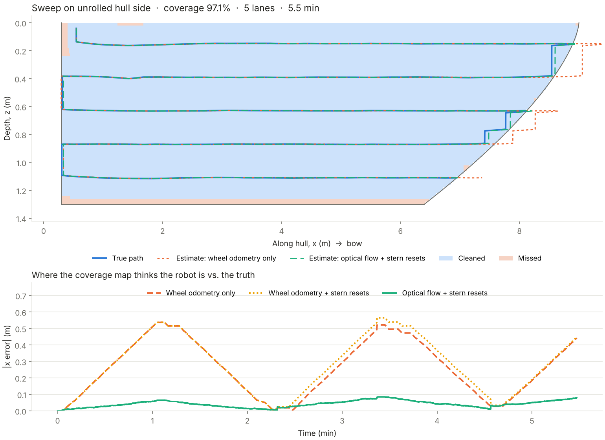

# Glaucus I

An autonomous robot that cleans boat hulls in the water. It crawls on the hull,
sweeps it in horizontal lanes like a lawnmower, and is supervised from a phone.



## Try it in two minutes (no robot, no ROS)

```bash
pip install -r webapp/requirements.txt

python3 sim/sweep_sim.py                    # simulate a sweep, writes docs/img/sweep_sim.png
python3 sim/sim3d.py --html build/sim3d.html   # same sweep on a curved 3D hull (viewer needs: pip install plotly)
python3 webapp/gateway/server.py --mock     # operator app at http://localhost:8000, driven by the sim
./tools/check_all.sh                        # every test that doesn't need ROS or hardware
```

## How it works, in one paragraph

Lanes are defined by **depth**, which a pressure sensor measures absolutely.
Heading comes from **gravity** (on a wall, the IMU can feel which way is down).
Lane ends are **detected** by fusing a camera "edge ahead" cue with a "stalled"
cue, not computed from position. So the sweep never depends on along-hull
position, which is the one thing that drifts. Full explanation, built up from
scratch: [docs/sweep_algorithm.md](docs/sweep_algorithm.md).

## Stack

| Where | What | Language |
|---|---|---|
| MCU (Teensy 4.1) | Heading + wheel loops, sensors, watchdog/safety | C++ (PlatformIO) |
| Raspberry Pi (on robot) | Sweep state machine, camera, cheap vision | C++, ROS 2 Jazzy |
| Topside (laptop, Wi-Fi AP) | Mission control, coverage map, logging, app gateway | Python, ROS 2 |
| Phone | Operator app | HTML/JS |

Why it's split this way: [docs/architecture.md](docs/architecture.md) and
[docs/decisions/](docs/decisions/).

## Repo layout

```
sim/                 algorithm sandbox (Python). Change the algorithm HERE first.
                     sim3d.py = the same controller on a curved 3D hull (docs/simulation.md)
ros2_ws/src/
  glaucus_core/      the sweep logic in C++, no ROS, unit + parity tested
  glaucus_bot/       nodes on the Pi (thin wrappers around glaucus_core)
  glaucus_topside/   nodes on the topside machine
  glaucus_interfaces/ messages + RunSweep action
  glaucus_bringup/   launch files, parameters, DDS config
firmware/            MCU firmware
shared/protocol/     Pi <-> MCU wire format (one header, used by both)
webapp/              gateway (FastAPI) + operator app
docs/                architecture, algorithm, control tuning, testing plan, decisions
tools/               check_all.sh, check_params.py
```

## Working with Claude Code

`CLAUDE.md` has the rules, commands, what's real vs. placeholder, and a
prioritized task list. Two project slash commands:

- `/check`: run all checks and fix failures
- `/algo-change <description>`: change the sweep algorithm the safe way
  (sim → C++ port → parity test → docs)

## Status

The algorithm, its C++ port, the wire protocol and the MCU heading code are
working and tested. ROS nodes are written but not yet built against a ROS
install. Hardware drivers and vision are placeholders (`TODO(glaucus)`).
See the table in `CLAUDE.md`.
