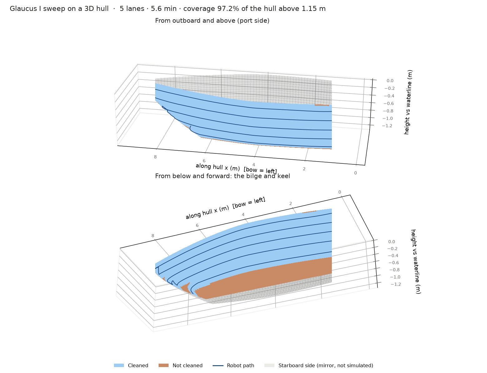

# Simulation: what we have, what we need, and the 3D environment

## 1. What exists today

One simulator: `sim/sweep_sim.py`, the **2D unrolled-sheet** sim. It runs the real
controller, detector and estimators against a statistical plant (slip, sag,
sensor dropouts) on a flat sheet, and its output feeds the C++ parity test.
That's the right tool for developing the algorithm, and it stays the
source of truth (CLAUDE.md rule 2).

What it can't tell us is anything that depends on the hull being **curved**. It
quietly assumes the hull is a vertical wall everywhere:

| 2D assumption | True only if… | Why it matters for Glaucus I |
|---|---|---|
| Driving down 24 cm of path = 24 cm more depth | the wall is vertical | lane spacing is set in *depth* (ADR 0003) |
| Gravity points along the wall everywhere | the wall is vertical | heading comes from gravity (ADR 0002/0005) |
| Depth-hold authority is the same everywhere | the wall is vertical | the depth loop steers with heading |
| Coverage = area of a flat sheet | the hull is developable | the customer sees paint, not a sheet |
| x along the sheet = hull station | the contour runs along the hull | coverage map + `x` estimator |

## 2. Which simulations we need

| # | Simulation | Answers | Tool | Status |
|---|---|---|---|---|
| S0 | 2D sheet, statistical plant | Does the algorithm work? Tuning. Parity trace for C++ | `sim/sweep_sim.py` | **done** |
| S1 | **3D hull kinematics** | Does the algorithm survive a curved hull? Where does depth-spacing break? | `sim/sim3d.py` | **done (this doc)** |
| S2 | Closed loop with the real stack | Does the C++ core + firmware heading code + wire protocol work against a fake robot? | fake-MCU ROS node wrapping the S0/S1 plant | next (CLAUDE.md task 1) |
| S3 | Contact + adhesion dynamics | Is there enough adhesion margin on the inclined/overhanging bilge? Wheel scrub in turns? Real slip vs. incline | MuJoCo (pip, no ROS) | needs real mass/adhesion numbers from hardware |
| S4 | Synthetic camera | Does `vision_node` find edges and optical flow in murky water with fouling? | Blender/Gazebo-rendered hull + water fog | after S2, and only if tank footage shows classical CV isn't enough |
| S5 | Water + tether | Currents, tether drag, buoyancy trim | not worth building before the tank test (testing_plan stage 4) | **skip for now** |

Rule of thumb for the order: build a simulation only when a design decision is
waiting on it. S1 was cheap (numpy, reuses S0 entirely) and the open question
was real. S3 and S4 need hardware numbers we don't have yet; building them
now would be modelling guesses.

## 3. The 3D environment (S1)

```bash
python3 sim/sim3d.py                          # run, print per-lane analysis, write docs/img/sim3d.png
python3 sim/sim3d.py --html build/sim3d.html  # + interactive viewer (pip install plotly)
python3 sim/sim3d.py --hull plane             # control case: must equal the 2D sim
python3 sim/sim3d.py --section-exp 2 --seed 7 # rounder hull, other seed
python3 sim/test_sim3d.py                     # geometry + plane==2D + curved sweep (also in check_all.sh)
```

The interactive viewer opens on the finished sweep: orbit/zoom it, or drag the
slider to replay the sweep with coverage growing. `.claude/launch.json` has a
`sim3d-viewer` entry that serves `build/` for the in-app browser.



### How it's built

- **Same brain, new body.** The controller, detector, estimators, parameters and
  the MCU heading loop are imported from `sweep_sim.py`, not copied. Only the
  plant and sensors are new. Nothing here changes the algorithm.
- **Hull**: `Hull3D` is a skin `y = Y(x, z)` with a superellipse cross-section
  (`section_exp`: 2 = round, bigger = boxier). Its planform comes from the 2D
  `Hull`, so lane ends match the 2D sim exactly (tested).
- **Heading is defined the way the IMU measures it**: θ = 0 is the *level*
  direction in the tangent plane, θ = +π/2 is *downhill*. On a vertical wall
  that's the sheet's heading. On a slope, θ = 0 still means "constant depth",
  which is why depth-defined lanes work at all.
- **What gets worse on a slope** is the share of gravity in the tangent plane,
  `sin α` (α = incline from horizontal). The IMU model mirrors
  `firmware/src/heading_estimator.h`: gyro + gravity complementary filter,
  gravity trust scaled by `sin α`, accel noise ∝ 1/`sin α`, and the gyro also
  sees the twist of the gravity frame along a curved path.
- **Camera / stall / flow** read the 3D geometry (edge ahead is marched along
  the skin; stall = commanded but not moving).
- **Coverage** is area-weighted on a 220×60 mesh of the skin, with the brush as a
  15 cm disc on the surface.

### Validation: the control case

`--hull plane` puts the same 3D plant on a vertical plane with the 2D planform.
It must reproduce the 2D sim, and `test_plane_reproduces_2d_sim` enforces it:
same lane count, time within 10%, coverage within 3 points. (Over 5 seeds: 5
lanes, 5.5 min, whole-sheet coverage 96.7% vs. 97.1%; x-estimate error
0.05 / 0.10 m mean / max vs. 0.04 / 0.08.) A curved-hull result is only worth
anything while this test passes. (An earlier version of the plant pinned the
robot at the keel edge and gave up after 3 lanes; that was my modelling
artifact, found by tracing the failure, and `test_advance_*` now guards it.)

### What it does NOT model

No contact or adhesion physics (S3), no water or tether (S5), no rendered camera
(S4). The statistical slip/sag/dropout numbers are the 2D sim's, unchanged. Only
the port side is simulated (starboard is drawn mirrored). **The hull
dimensions are placeholders** (9 m, 1.3 m draft, 1.5 m half-beam): put the real
boat's numbers in `Hull3D(...)` before believing any specific percentage.

## 4. What it shows

Default hull, 5 seeds each (`--section-exp 4 / 3 / 2`):

| | plane (= 2D) | boxy (n=4) | n=3 | round (n=2) |
|---|---|---|---|---|
| Lanes · time | 5 · 5.5 min | 5 · 5.6 | 5 · 5.6 | 5 · 5.5 |
| Coverage of hull above 1.15 m (surface area) | 99.5% | 97.3% | 96.3% | 93.9% |
| Surface distance between lane 3 and 4 (brush 0.30 m) | 0.24 | 0.30 | 0.35 | 0.41 |
| Worst per-lane depth RMS | 0.5 cm | 0.6 cm | 0.6 cm | 0.7 cm |
| Mean heading error | 0.7° | 1.0° | 1.0° | 1.0° |
| `x` estimate error, mean / max (flow + stern reset) | 0.05 / 0.10 m | 0.17 / 0.70 | 0.18 / 0.81 | 0.13 / 0.48 |

1. **The algorithm itself holds up.** Depth hold stays within ~1 cm and heading within
   ~1° even where `sin α` drops to ~0.35, and every seed finishes 5 lanes in the
   same time as 2D. The gravity-trust fallback in the firmware filter does its job.
   ADR 0002/0005's claims survive a curved hull.
2. **Depth-defined lane spacing under-covers the bilge.** Lanes are 24 cm apart in
   *depth*, but on a slope that's `0.24 / sin α` of *surface*. At `sin α ≈ 0.65`
   the spacing reaches the brush width (zero overlap); on a rounder hull it's
   0.41 m against a 0.30 m brush. Coverage in the 0.9–1.1 m band falls to 89%
   (n=4) / 73% (n=2). This is geometry, not tuning: it appears on any hull
   whose side curves under within the swept depth. **The fix is probably
   incline-aware spacing**: step down by `lane_spacing · sin α`, with `sin α`
   measured from the in-plane gravity the IMU already sees. That is an algorithm
   change, so it goes through `/algo-change` (sim first, then C++ + parity), and
   ADR 0003 deserves a caveat meanwhile.
3. **The `x` estimator is ~3–4× worse than ADR 0005's table**, because `x += ds·cos θ`
   assumes the level direction is the hull axis, and near the bow wedge it isn't.
   Worst-case 0.7 m. Only the coverage map is affected, never the sweep, but if
   the map needs to be tight, `x` has to be an arc-length coordinate or be
   corrected from the hull's planform.
4. **A large part of the port skin is never cleaned, almost all of it below 1.15 m.**
   Whole-skin coverage is only 62% (boxy hull) to 72% (round hull), and ~96% of
   the uncleaned area lies below `max_depth`, where the bilge/bottom is nearly
   horizontal. That's ADR 0003's "flat bottom out of scope", now quantified: the
   2D sim hid it by only modelling the sheet down to the draft.

All four are conditional on the placeholder hull. Finding 2 is a property of
the geometry; the exact percentages are not.

## 5. Where to take it next

- Put the real hull's section in (offsets table or a few measured stations) and
  re-run; this is the single highest-value edit.
- Prototype incline-aware spacing in `sweep_sim.py` using a sloped sheet, then
  port and check it with `sim3d.py`.
- S2: a fake-MCU node that wraps the `Plant3D` so the C++ executor can be launch-tested.
