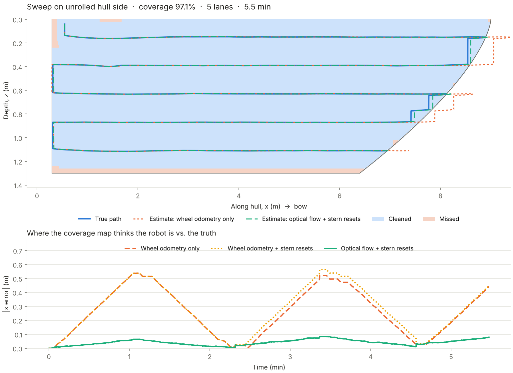
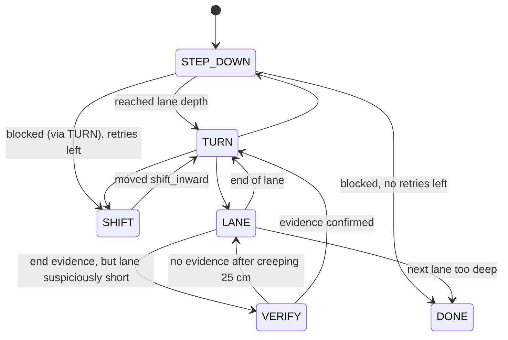

# The sweep algorithm, built up from scratch

This is the "how does the robot actually clean a hull" doc. It starts from the
simplest idea and adds one piece at a time. Every piece maps to code in
`sim/sweep_sim.py` (Python sandbox) and `ros2_ws/src/glaucus_core` (C++ port).



*Output of `python sim/sweep_sim.py`. Top: the robot's path on the hull side
(blue), what the coverage map thinks happened, and what got cleaned. Bottom:
how wrong the along-hull position estimate is over time.*

---

## 1. Flatten the hull

A hull side is curved, but the robot is stuck to it, so we can pretend it's a
flat sheet, like peeling the label off a bottle and laying it on a table.
Two coordinates describe any spot on that sheet:

- **x**: how far along the hull, from the stern (0) toward the bow
- **z**: how deep below the waterline (positive = down)

And one angle describes which way the robot is pointing:

- **heading**: 0 = facing the bow, 180° = facing the stern, +90° = facing straight down

Everything below happens on this flat sheet.

## 2. The lawnmower

To cover a lawn you mow a stripe, turn around, shift over by a little less than
the mower's width, and mow back. That pattern is called **boustrophedon**
(Greek for "how an ox turns while plowing").

On the hull, the stripes are horizontal **lanes**:

```
 waterline ───────────────────────────────────────────
   lane 0   ●────────────────────────────────────────►┐
   lane 1   ┌◄───────────────────────────────────────┘
   lane 2   └────────────────────────────────────►┐
   lane 3        ┌◄─────────────────────────────┘     (bow curves in,
            ...                                       lanes get shorter)
 stern                                          bow
```

Lane spacing = brush width × (1 − overlap). With a 30 cm brush and 20% overlap
that's 24 cm. The overlap is insurance: small errors in depth won't leave
uncleaned stripes between lanes.

## 3. The big idea: depth is the ruler you can trust

Here's the trick that makes this whole thing tractable on a $2k budget.

A pressure sensor tells you depth **directly**. It doesn't drift. Ask it after
an hour and it's as accurate as after a second. So:

> **A lane is "everything at depth z". You don't need to know x to stay in a lane.**

And the ends of a lane don't need x either: the robot **detects** when it hits
the end (section 6) instead of calculating where the end should be.

So the sweep pattern never uses x at all. x only matters for drawing the
coverage map. This means odometry drift (which is unavoidable) can make the
*map* a bit wrong, but it can never make the robot clean the wrong place.

## 4. Holding a lane: "aim slightly uphill"

Driving "horizontally" on a wall, the robot slowly slides down (gravity) and
wanders (bumps, uneven fouling). How do you stay at depth z?

Think of driving along a hillside road. If you've drifted too low, you aim the
car slightly uphill. The further off you are, the more you aim uphill.

That's a **proportional (P) controller**:

```
depth_error       = depth − lane_depth          (positive = too deep)
heading_offset    = Kp × depth_error            (aim up by this much)
```

With `Kp = 2.0 rad/m`, being 5 cm too deep means aiming up by 0.1 rad ≈ 6°.

One problem: gravity pulls down *constantly*. A P controller only pushes back
when there's already an error, so it settles at a small permanent sag. Fix:
also add up the error over time. If you've been a little too deep for a while,
aim up a little more. That's the **I** in **PI**:

```
integral        += depth_error × dt
heading_offset   = Kp × depth_error + Ki × integral
```

Two safety rails:

- **Clamp** the offset (±20°) so it never steers wildly.
- **Anti-windup**: clamp the integral too, so it doesn't build up a huge value
  while the robot is turning or stuck, then overshoot when it starts moving.

Last detail: "uphill" is a left turn going one way along the hull and a right
turn going the other way. So the offset gets multiplied by the lane direction
(+1 toward the bow, −1 toward the stern):

```
heading_cmd = lane_heading − direction × heading_offset
```

Code: `SweepController._depth_hold_heading` (Python) / `depth_hold_heading` (C++).

## 5. Two loops, one fast and one slow

The depth controller outputs a *heading* to aim for. Something still has to
turn the wheels to actually point that way. That's a second controller:

```
          Pi, 20 Hz                       MCU, 200 Hz
 depth ──► [depth PI] ──► heading_cmd ──► [heading P] ──► turn rate ──► left/right wheel speeds
   ▲                                          ▲
   └── pressure sensor                        └── IMU heading
```

This is a **cascade**. The inner loop (heading) is fast and lives on the
microcontroller, because it has to react to every wobble and must keep running
even if Linux on the Pi hiccups. The outer loop (depth) is slow, because depth
changes slowly.

Rule of thumb: inner loop at least 5–10× faster than outer loop, and **tune the
inner loop first** with the outer loop switched off. See
[control_design.md](control_design.md) for the tuning procedure.

### Where heading comes from (no compass needed)

On a vertical wall, the accelerometer can feel which way is "down" *in the
robot's own frame*. Down is +90° in our heading convention. So the IMU gives an
**absolute heading** that doesn't drift. A magnetometer would be useless next
to a steel hull and motors anyway.

Accelerometers are noisy (brush vibration), gyros are smooth but drift, so we
blend them: trust the gyro moment to moment, and let gravity slowly pull it
back to the truth. That's a **complementary filter**
(`firmware/src/heading_estimator.h`).

Caveat: near the bottom of the hull, the wall tilts toward horizontal and
"down" stops being visible in the hull plane. The filter quietly falls back to
the gyro there. Fine for short stretches.

## 6. Knowing when a lane ends

This is the part you said you weren't sure about. Here's the approach and why.

**The cues you have:**

| Cue | What it sees | Fails when |
|---|---|---|
| Camera "edge ahead" | Hull ends / open water / obstacle ahead | Murky water (misses); fouling patch looks like an edge (false alarm) |
| Stall | Commanding motion but not moving (camera optical flow ≈ 0, or motor current spike) | Only fires once you've already hit something |
| Lane length so far | "Previous lane was 8 m, I've done 3" | Not a cue on its own, but makes others more or less believable |

No single cue is good enough. So we **fuse** them:

```
score = 0.6 × camera_edge + 0.6 × stall          (each 0..1)
end_of_lane = score > 0.5 for 4 control ticks in a row
```

Why this works:

- Camera alone at full confidence (0.6) crosses the threshold. That's the
  normal case: see the edge, stop before hitting it.
- Stall alone (0.6) also crosses it. That's the backup when the camera misses.
- A single-frame glitch from either sensor doesn't last 4 ticks (0.2 s), so
  it's ignored. That's the **debounce**.

Code: `EndOfLaneDetector`.

### "Are you sure?" for suspiciously short lanes

The sim found a real failure: a camera glitch and a stall glitch happened
together for 4 ticks, mid-hull. The robot thought the lane was over at 1 m
from the stern instead of at the stern.

Fix: if a lane ends much shorter than the previous one
(`lane < previous − 0.6 m`), don't believe it yet. Switch to **VERIFY**: creep
forward slowly for 25 cm. If the end evidence comes back, it was real (maybe an
obstacle). If not, it was a false alarm. Go back to cleaning. The 0.6 m margin
is there because lanes legitimately get shorter at the bow as you go deeper.

## 7. Turning around and going deeper

At the end of a lane:

1. **TURN** in place to face straight down.
2. **STEP_DOWN**: drive down until the depth sensor says you're at the next
   lane's depth.
3. **TURN** to face the other way.
4. **LANE**: clean back the other way.

Because step-down is measured by the depth sensor, lane spacing is accurate
even though wheel odometry isn't.

### When you can't go deeper

At the bow, the hull curves away beneath you (the "cutaway"). Driving straight
down from the end of a lane there runs off the hull. The robot detects this the
same way it detects lane ends (camera + stall), then:

- **SHIFT**: back up along the lane toward the middle by 35 cm, then try
  stepping down again. Retry up to 3 times.
- If it still can't go deeper, the sweep is done.

The sweep also finishes when the next lane would be deeper than `max_depth`
(set per boat: roughly draft − half a brush width).

## 8. The whole state machine



## 9. Where am I along the hull? (the coverage map's problem)

The robot sweeps fine without knowing x. But the app wants to show *which
parts are clean*, and that needs x.

**Wheel odometry**: count wheel rotations. Wheels slip on slimy hulls, so it
over-counts. In the sim, wheel-only x error swings up to ~0.5 m.

Things we tried in the sim, and what happened:

| Idea | Result | Why |
|---|---|---|
| Snap x to a known value when you hit the stern (the transom is ~vertical) | **Barely helped** | Steady slip over-counts going toward the bow and over-counts coming back, so it mostly cancels on each round trip anyway |
| Calibrate slip during step-downs (depth sensor says how far you really went) | **Didn't work** | Gravity helps you going down, so down-slip ≠ sideways-slip |
| **Optical flow** (camera watches the hull slide by, like an optical mouse) + stern snaps | **~0.05 m error** | Measures real motion, so slip doesn't matter |

So: build the sweep on depth + edge detection (doesn't need x), and treat
optical flow as the upgrade that makes the coverage map trustworthy. The snap
only happens if x is already within 0.5 m of the stern. That stops a false
end-of-lane mid-hull from teleporting the estimate.

## 10. Honest list of what can still go wrong

- **Big obstacles mid-lane** (zinc anodes, through-hull fittings, transducers):
  VERIFY confirms them as a lane end, so the robot turns early and leaves the
  rest of that lane dirty. Next step: an obstacle bypass maneuver (step down,
  pass under, step back up).
- **Flat bottom of the hull**: heading-from-gravity degrades. The current
  design stops at `max_depth` and doesn't attempt the bottom.
- **Waves at the dock**: depth sensor noise. Low-pass filter the depth reading
  (TODO in `WallEstimator`).
- **Adhesion loss**: entirely the MCU's job (stop, hold, alarm). The sweep
  logic assumes the robot stays on the hull.
- **The sim is optimistic** about how clean the camera signal is. The weights
  and thresholds above are starting points. Record bags in the tank and tune
  from real data.

## How to change the algorithm

1. Edit `sim/sweep_sim.py`. Run it. Look at the plot. Try a few `--seed`s.
2. Port the change to `ros2_ws/src/glaucus_core` (same names, same order).
3. Regenerate the trace and run the parity test:
   ```bash
   python sim/sweep_sim.py --quiet --dump-trace ros2_ws/src/glaucus_core/test/data/sim_trace_seed2.csv
   ./tools/check_all.sh
   ```
   The parity test replays the Python run through the C++ controller and fails
   if a single command differs.
